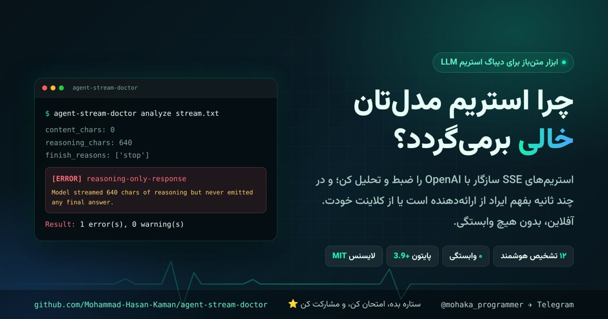

<p align="center">
  
</p>

### 🌐 Telegram: [@mohaka_programmer](https://t.me/mohaka_programmer)

[](https://t.me/mohaka_programmer)

---

# 🩺 agent-stream-doctor

[](https://github.com/Mohammad-Hasan-Kaman/agent-stream-doctor/actions/workflows/ci.yml)
[](LICENSE)
[](pyproject.toml)

**Diagnose why your LLM stream gave you nothing.**

`agent-stream-doctor` analyses raw OpenAI-compatible chat completion streams and tells you exactly what went wrong: empty streams, reasoning-only responses, missing `finish_reason`, malformed SSE, and truncated tool calls.

Zero dependencies. Works offline on captured streams.

---

## Why this exists

If you build agents on top of OpenAI-compatible APIs (or routers in front of them), you have probably seen failures like:

- The response area stays **empty** while the provider dashboard happily counts thousands of tokens.
- A model "thinks" out loud for minutes and then produces **no final answer**.
- Your tool-calling loop hangs because a tool call was **cut off mid-arguments**.
- Everything works against one provider and silently breaks through another router.

These are hard to debug because by the time you look, the response is gone. This tool captures the raw SSE text once (`record`) or takes a saved capture (`analyze`) and turns it into a precise diagnosis - so you can tell an upstream bug from your own client bug in seconds.

The reasoning-only detection was built after hitting this exact failure class in practice ([NousResearch/hermes-agent#92803](https://github.com/NousResearch/hermes-agent/issues/92803)): a model streamed long reasoning, then returned no answer at all.

## Install

```bash
pip install git+https://github.com/Mohammad-Hasan-Kaman/agent-stream-doctor.git
```

Or from source:

```bash
git clone https://github.com/Mohammad-Hasan-Kaman/agent-stream-doctor.git
cd agent-stream-doctor
pip install -e .
```

## Quick start

### Diagnose a live request

```bash
export OPENAI_API_KEY="sk-..."

agent-stream-doctor record \
  --base-url https://api.openai.com/v1/chat/completions \
  --model gpt-4o-mini \
  --message "Hello!" \
  --out stream.txt
```

This calls the endpoint with `"stream": true`, saves the raw SSE text to `stream.txt`, and prints a report:

```
agent-stream-doctor report
----------------------------------------
  data_chunks: 1
  done_sentinels: 1
  json_errors: 0
  sse_line_errors: 0
  content_chars: 0
  reasoning_chars: 640
  finish_reasons: ['stop']
  roles_seen: ['assistant']

[ERROR  ] reasoning-only-response
         Model streamed 640 chars of reasoning but never emitted any final answer content.
         why: The model streamed reasoning/thinking content but never produced a final answer. Some routers drop or mis-map reasoning channels; your client may need to fall back to a non-streaming request or a different model when this pattern appears.

Result: 1 error(s), 0 warning(s)
```

Exit codes are script-friendly: `0` = healthy, `1` = problems found, `2` = usage error. Add `--json` for machine-readable output you can plug into CI.

### Diagnose a captured stream

Already have a failing response saved from your app's logs? Analyze it offline:

```bash
agent-stream-doctor analyze stream.txt
```

### Use as a library

```python
from agent_stream_doctor import diagnose

with open("stream.txt", encoding="utf-8") as f:
    report = diagnose(f.read())

if not report.healthy:
    for finding in report.findings:
        print(f"[{finding.severity.value}] {finding.check_id}: {finding.message}")
        print(f"    {finding.explanation}")
```

## What it detects

| Check | Severity | Meaning |
|---|---|---|
| `empty-stream` | error | Server closed without sending any data |
| `reasoning-only-response` | error | Reasoning content arrived, final answer never did |
| `empty-content-stream` | error | Stream ended normally but every content delta was empty |
| `missing-finish-reason` | error | No chunk ever terminated the choice properly |
| `inconsistent-finish-reason` | warning | Multiple distinct finish_reasons - merged/replayed streams |
| `malformed-sse-line` | error | Lines that do not follow the SSE format |
| `invalid-json-payload` | error | `data:` payloads that are not valid JSON |
| `data-after-done` | warning | Chunks sent after the `[DONE]` sentinel |
| `stream-ended-without-done` | warning | Stream ended without `[DONE]` - some clients hang forever |
| `incomplete-tool-call` | error | Tool-call deltas arrived but never finished |
| `unparseable-tool-arguments` | error | Concatenated arguments are not valid JSON |
| `role-not-announced` | info | No delta.role - harmless for most clients |

Reasoning content is recognised across common vendor shapes: `delta.reasoning_content`, `delta.reasoning`, and `delta.thinking`.

## Design notes

- **Pure text analysis.** `diagnose()` takes the raw SSE text and returns findings. No network calls, no magic.
- **Tolerant parser.** A diagnostic tool that crashes on malformed input is useless - every deviation becomes a finding instead of an exception.
- **Explanations included.** Every check ships with a short "why this happens / what to do" string, so reports teach instead of just alarming.
- **Stdlib only.** The core library imports nothing beyond Python itself. The `record` command needs `requests`, installed separately.

## Roadmap

- [ ] `pytest` plugin fixture: assert `report.healthy` inside integration tests
- [ ] Async recorder (`httpx`)
- [ ] Usage/token accounting checks (`stream_options.include_usage`)
- [ ] Optional HTML report

Contributions welcome - see [CONTRIBUTING.md](CONTRIBUTING.md).

## Testing

```bash
pip install -e ".[dev]"
pytest
```

## License

MIT - see [LICENSE](LICENSE).
